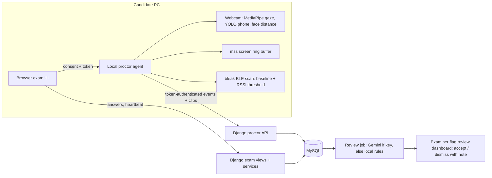

# Design: Technoverse Secure Examination Management System

## Overview
Django 5.1 monolith (MySQL) with server-rendered templates and small vanilla JS modules. Business logic sits in service functions. A separate local Python agent provides proctoring signals and talks to a token-authenticated API. The web app works fully without the agent.

## Existing foundation (already in repo)
- Models: `Question` (with difficulty), `QuestionChoice`, `Examination` (state, randomize flags, results_published), `ExaminationQuestion`, `Enrollment`, `Attempt` (expires_at, unique per exam and candidate), `AttemptQuestion` (snapshot), `AttemptAnswer`, `ExaminationEvent`.
- Services: `start_attempt`, `save_answer`, `expire_attempt_if_needed`, `finalize_attempt`.
- Views: examiner exam, enrollment, question bank, candidate dashboard, attempt workspace, save, review, submit.
- Missing: admin management, monitoring, announcements, grading, results, analytics, reports, import, sandbox, preferences, scratchpad, proctoring.

## Architecture

## Data model additions

| Model | Purpose | Key fields |
|---|---|---|
| `ExamBlueprint` | 5.2 difficulty ratio | examination (1:1), easy_count, medium_count, hard_count, category (optional) |
| `Attempt` (changes) | seed, sandbox | `random_seed`, `is_sandbox`; unique constraint only where `is_sandbox=False` |
| `AttemptAnswer` (or `Attempt`) | 4.8 | scratchpad text per attempt |
| `UserPreference` | 4.7 | user (1:1), font_size, theme, palette_position, density |
| `VerifiedReport` | 4.6 | public_id (unique, token), report_type, attempt/examination ref, data_hash (SHA-256), issued_at, status (valid, revoked, superseded) |
| `ProctorSession` | 5.1 | attempt, consent_at, token_hash, last_seen |
| `ProctorEvent` | 5.1/5.5 | session, type, severity, occurred_at, details JSON |
| `ProctorClip` | 5.1 | event, private file path, size, created_at |
| `DeviceBaseline` | 5.5 | session, hashed device ids, rssi, captured_at |
| `AIReview` | 5.1 | session or attempt, source (gemini or local), summary JSON, created_at |
| `ReviewDecision` | 5.1 | event, decided_by, decision (accept or dismiss), note, decided_at |
| `ImportJob` (optional) | 4.4 | type, uploaded_by, status, error report |

All new models require migrations. The `Attempt` unique constraint change needs a data-safe migration.

## Permissions model
- `role_required` plus ownership helpers on every examiner view.
- Candidate views filter on `request.user`.
- Admin views require the admin role.
- Proctor API uses a per-attempt token (stored hashed), valid only while the attempt is IN_PROGRESS. Candidates have no read access to proctor data.
- Public: only `/verify/<public_id>/` and the manual lookup form.

## Server-side timing and idempotency
- `expires_at = min(started_at + duration, exam.ends_at)`, computed on the server.
- `save_answer` rejects writes after `expires_at`. Queued offline answers carry a client sequence number and are accepted only if the server receives them before the deadline.
- `finalize_attempt` is transactional and idempotent. Double submit returns the same result.

## Fairness blueprint algorithm (5.2)
1. Examiner sets `easy_count`, `medium_count`, `hard_count` (and optional category) on the exam.
2. At publish time, validate that the examiner's bank has at least that many questions of each difficulty (matching the category).
3. At `start_attempt`, create a seed (`secrets.randbits(64)`), store it on the attempt, and use `random.Random(seed)` to sample each bucket without replacement, then shuffle the combined order if `randomize_questions` is set.
4. Snapshot prompt, type, marks and choices into `AttemptQuestion`. Shuffle choices with the same RNG if `randomize_choices` is set.
5. Total marks come from the drawn set. Fixed counts keep papers comparable while preserving variation.
6. Reopening an attempt reads the snapshot and never redraws.

## Network-aware interface and resilience (4.1, 5.3)
- JS monitors `online` and `offline` events and a heartbeat ping (`/ping/`) every few seconds to classify Saved, Saving, Offline (will retry), Unstable.
- Unsent answers go to `localStorage` with an incrementing sequence number and are replayed in order. The server rejects anything after the deadline. The remaining time always comes from the server.

## Sandbox (4.3)
- `Attempt.is_sandbox=True` for examiner previews. A default manager `Attempt.objects` excludes sandbox, and `Attempt.all_objects` includes it. Monitoring, grading, analytics, reports and results use the default manager.
- Sandbox skips the enrollment and window checks but still enforces the exam's own timer in the preview UI.

## Bulk import (4.4)
- Upload CSV or JSON, parse with strict validation (required columns, types, difficulty values, choice rules), build a preview with row-level errors, and commit inside one transaction only when the user confirms. Size limit and encoding checks. Downloadable templates.

## Analytics (3.8, 4.5)
- Service function computes average, median, min, max and a distribution for each exam, and for each question: skip rate, correct rate, most-chosen wrong option, observed difficulty (correct rate) versus labelled difficulty. CSV export. Excludes sandbox.

## Verifiable reports (4.2, 4.6)
- ReportLab renders the candidate result report and the examiner exam summary. The QR code (qrcode or segno) encodes `https://<host>/verify/<public_id>/`.
- `public_id = secrets.token_urlsafe(16)` (128 bits). `data_hash = sha256(canonical JSON of the report data)`.
- Verify page recomputes the hash from current data to detect tampering with stored results. It shows: status (authentic, revoked, superseded), exam title, issue date, masked candidate name (initial plus asterisks), score and total. Nothing else.
- Regrade sets older reports to `superseded`. Unknown IDs return the same "not found" page. The endpoint is rate-limited per IP.

## Proctoring agent architecture (5.1, 5.5)
- Package `proctor_agent/`: `python -m proctor_agent --server URL --token T [--simulate]`.
- Modules: `config`, `uplink` (retry queue, signed token), `gaze` (MediaPipe Face Mesh, iris and head pose, state machine with N-second threshold and debounce), `distance` (pinhole model, one-time calibration), `phone` (YOLOv8n, consecutive-frame filter), `screen` (mss ring buffer), `bluetooth` (bleak baseline and diff), `identity` (optional), `simulate` (video playback and mocked scanner).
- Events: GAZE_AWAY, NO_FACE, MULTIPLE_FACES, PHONE_DETECTED, BT_DEVICE_NEARBY, ID_MISMATCH, AGENT_OFFLINE. Each has a severity and a short detail payload. No raw biometric data in logs.

### Distance and Bluetooth model (5.5)
- Distance: `d = f_px * W_face / w_px`, with `W_face` about 0.15 m and `f_px` calibrated once at a known distance.
- Path loss: `rssi(d) = tx_power - 10 * n * log10(d / 1 m)`. Defaults `n = 2.5` for indoors. If baseline devices have known positions (for example the keyboard), calibrate `tx_power` and `n` from them.
- Threshold: flag a new device if `rssi >= rssi(d_candidate * 1.5)`, which means closer than about 1.5 times the candidate's distance. Audio-class devices (by name or service UUIDs) rank as higher severity.
- Device addresses are hashed with a per-session salt before upload.
- Known limits: RSSI is noisy, many earbuds do not advertise in their case or while connected. Output is advisory.

## Optional-AI fallback policy
- Required features never call a paid API. Gemini review runs only if `GEMINI_API_KEY` is set. With no key or on failure, a local rule-based summary lists counts, durations and timestamps of flags. Media is downscaled and only flagged evidence is sent.
- The agent has `--simulate` for demos without hardware.

## Examiner review (3.6, 5.1)
- Timeline per attempt combining events, clips, AI summary. Accept or dismiss requires a note. Decisions are stored and shown in result review. No decision changes a score.

## Testing strategy
- Unit tests for services (blueprint draw, scoring, analytics, report hash and masking, baseline diff, distance-to-RSSI, gaze state machine, consecutive-frame filter).
- View tests for every new URL: allowed role succeeds, other roles get 403 or 404, anonymous redirects.
- Manual end-to-end checklist for the demo.

## Risks
| Risk | Mitigation |
|---|---|
| 10-hour limit | Priority order and cut-line in `tasks.md` |
| Heavy agent installs (mediapipe, ultralytics) | Separate requirements, simulated mode, optional |
| Hardware unavailable on deployed host | Agent runs locally for live demo, simulated for deployed demo |
| Bluetooth accuracy | Baseline diff, advisory wording, documented limits |
| `Attempt` constraint change | Dedicated migration and tests |
| False flags harming candidates | Advisory-only, human accept or dismiss, no score effect |
